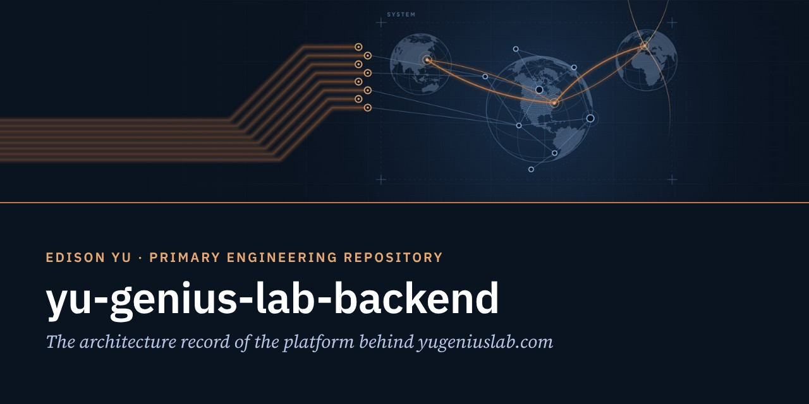
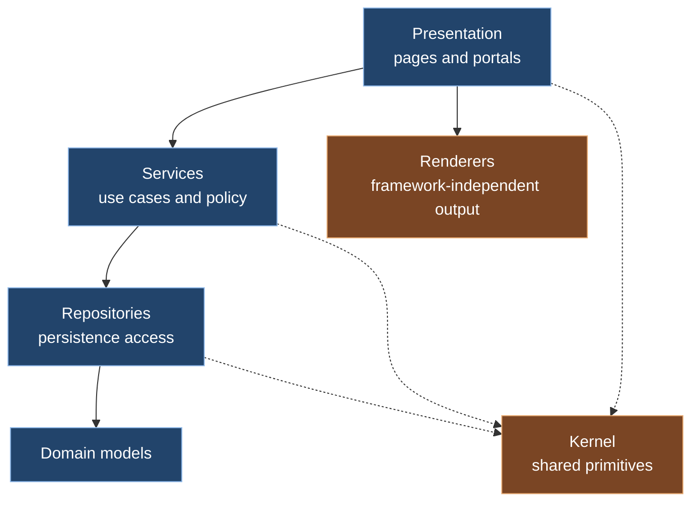
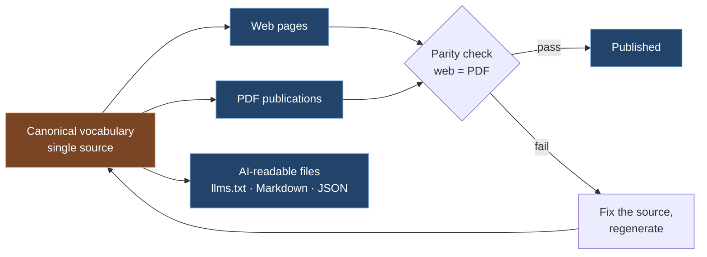
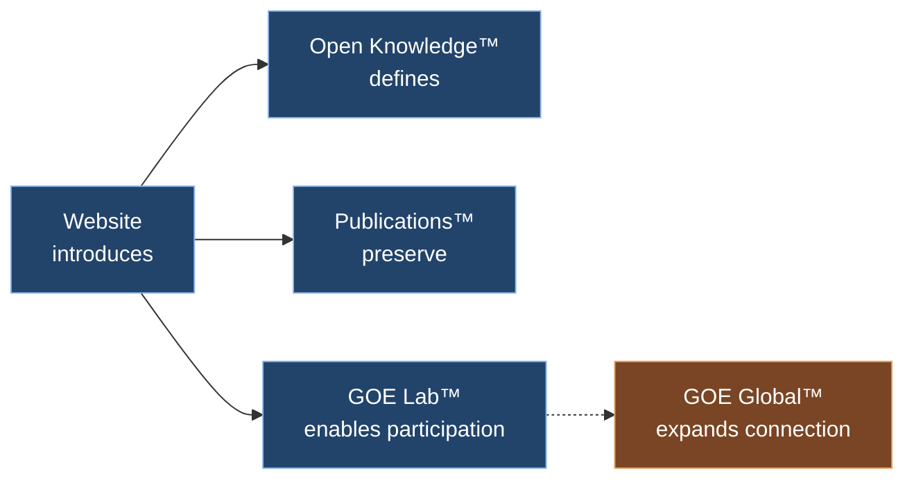

  

# Yu Genius Lab Backend

**The architecture record of the platform behind [yugeniuslab.com](https://www.yugeniuslab.com/).**
Primary Engineering Repository of Edison Yu · Identity · Trust · Authorization · Connection

> This repository documents how the platform is designed and why. The production source code is maintained privately.
> The philosophy is public; the implementation remains confidential.

---

## Purpose

**Why it exists.** To show how I build: how a platform is structured, how its boundaries are kept, and how decisions are made and recorded.

**What problem it solves.** Yu Genius Lab publishes one body of knowledge in many forms: web pages, downloadable PDFs, and AI-readable files. The same canonical vocabulary has to read identically everywhere, across dozens of revisions, while a private, authenticated workspace (GOE Lab) runs on the same platform. The core engineering risk is drift: between pages, between formats, and between layers of the code.

**How it fits the ecosystem.** Yu Genius Lab publishes knowledge. This platform is the engineering that makes that publishing consistent, verifiable, and maintainable.

## Identity

| | |
|---|---|
| Platform | The Edison Yu Platform: the website, Open Knowledge™, Publications™, and the GOE Lab™ workspace |
| Role in the ecosystem | The engineering foundation under Yu Genius Lab |
| Stack | Python · Django · PostgreSQL · containerized cloud deployment |
| Method | Documentation-first, architecture before implementation, AI-assisted engineering |

## Architecture

The platform is a layered system. Dependencies point downward only, and the rules are checked automatically on every change.

**Boundary rules**

- Presentation never touches persistence directly.
- Modules use one another only through their public interfaces.
- Renderers never import the web framework, so output logic stays portable and testable.
- The kernel depends on nothing above it.
- These rules are written as architecture contracts and run with the test suite, so a violation fails the build instead of waiting for a code review.

### Flow: one source, every format

Every canonical statement lives in one place. Pages, PDFs, and AI-readable files are generated from it, and an automated check confirms that each PDF carries the same text as its web page before it is published.

### Relationships

## Engineering decisions

Decisions are recorded as short Architecture Decision Records in [`docs/decisions`](docs/decisions):

| ADR | Decision |
|---|---|
| [0001](docs/decisions/0001-documentation-before-development.md) | Documentation before development |
| [0002](docs/decisions/0002-single-source-canonical-vocabulary.md) | One source for the canonical vocabulary |
| [0003](docs/decisions/0003-enforced-architectural-boundaries.md) | Architectural boundaries enforced by automated contracts |
| [0004](docs/decisions/0004-one-publication-two-formats.md) | One publication, two formats, verified parity |

## Quality and security practices

- Automated tests, linting, and architecture contracts run on every change.
- Publications are regenerated from source and checked for web/PDF parity before release.
- Secrets live only in the runtime environment, never in a repository. Secret scanning and push protection are enabled.
- Private areas of the platform are excluded from search indexing.

## What is intentionally not here

Source code, database structures, internal APIs, authentication and authorization designs, security architecture, infrastructure designs, and deployment procedures stay private. This follows the [public disclosure principles](https://www.yugeniuslab.com/publications/goe-operating-system/) of GOE Operating System™.

## Relationship to GOE

GOE provides the operating framework. This platform is where its principles are practiced in a working system: identity, trust, and authorization are treated as platform primitives, and human intention stays the source of every action.

## Relationship to Yu Genius Lab

Yu Genius Lab publishes knowledge. This platform keeps that knowledge consistent across every page and format, so that the website, the publications, and [Open Knowledge™](https://www.yugeniuslab.com/open-knowledge/) say the same thing in the same words.

## Vocabulary

| Term | Meaning here |
|---|---|
| Canonical vocabulary | The single source of every official statement, name, and definition used on the platform |
| Architecture contract | An automated rule that fails the build when a dependency crosses a boundary it should not cross |
| Publication parity | The guarantee that a publication's PDF carries the same content as its web version |
| GOE Lab™ | The trusted participation layer of the ecosystem, and its private workspace |
| Open Knowledge™ | The canonical public knowledge source for the Edison Yu ecosystem |

## Future Direction

- Record new decisions as ADRs as the platform evolves.
- Review the publication tooling for a possible open-source release.
- Keep this record in step with each website revision.

## References

- [Yu Genius Lab](https://www.yugeniuslab.com/)
- [Open Knowledge™](https://www.yugeniuslab.com/open-knowledge/)
- [The Python & Backend Philosophy](https://www.yugeniuslab.com/publications/python-backend-philosophy/)
- [GOE Operating System™ white paper](https://www.yugeniuslab.com/publications/goe-operating-system/)
- Companion repositories: [goe-architecture](https://github.com/ilsooedisonyu/goe-architecture) · [python-backend-philosophy](https://github.com/ilsooedisonyu/python-backend-philosophy)

---

© 2026 Edison Yu. All rights reserved. You may read, link to, and quote short excerpts with attribution. · Engineering Repository™ · Revision 2026.70
